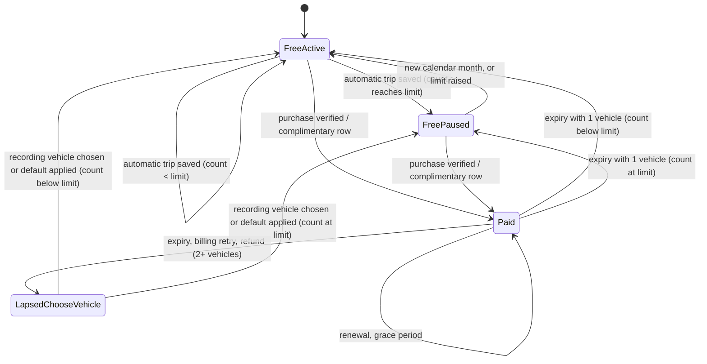
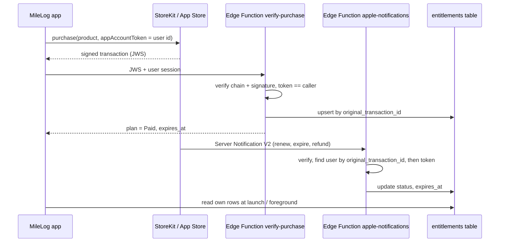
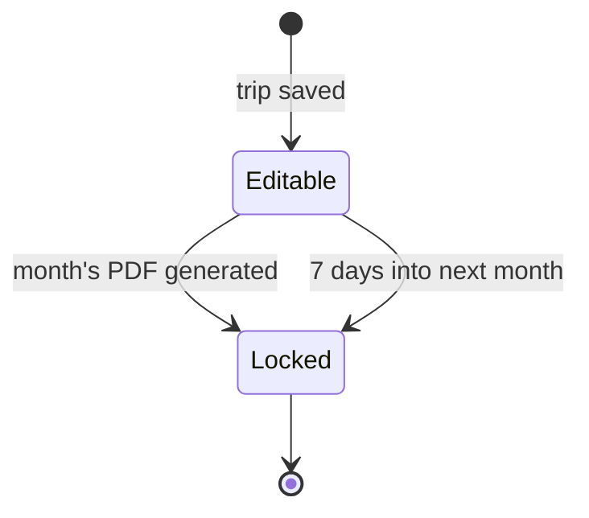

# Free and Paid Versions - Plan

## Goal Capsule

- **Objective:** Drivers can use MileLog for free with a monthly allowance of automatic trips, subscribe to get unlimited automatic tracking and a clean month-end report, and find MileLog on the App Store.
- **Means:** StoreKit 2 subscriptions verified by Supabase Edge Functions into an account-owned entitlement, a trip-source-based monthly allowance, and a month-end check on top of the existing trip data (KTD4, KTD5, KTD2).
- **Product authority:** The Product Contract below (decisions made with the app owner on 2026-10-20) wins on product behavior; Key Technical Decisions win on mechanism within it. More languages, the desktop/web app and company plans are not active scope.
- **Execution profile:** Deep. Payments, account deletion, database migrations and new server functions. Work in the unit order of the Phased Delivery section; U13 (schema baseline) comes first and U3 is a proof-first spike. A migration that adds a column is applied and checked before any build that sends it is uploaded.
- **Stop conditions:** Stop and ask if Apple's signed-transaction verification cannot run in Supabase Edge Functions and the Node fallback in KTD7 is also blocked, or if a change would alter a Product Contract rule.
- **Tail ownership:** The app owner does the App Store Connect and Supabase dashboard steps listed under Operational / Rollout Notes; the implementer prepares everything those steps need.
- **Open blockers:** None.

---

## Product Contract

**Product Contract preservation:** changed: added R25 (month-aware trip locking) and R26 (Apple ID already subscribed on another MileLog account), and clarified R9 to cover manual recording — all three confirmed by the owner in the planning synthesis of 2026-10-20. Outstanding Questions from the brainstorm are resolved in KTD2, KTD9, KTD13, KTD14 and KTD15.

### Summary

MileLog gets a free version with a monthly allowance of automatic trips and a paid subscription that removes the limit and adds PDF reports, receipt scanning, a new month-end check and extra vehicles.
It first goes to 10–20 drivers through TestFlight with everything unlocked; their real usage sets the final allowance and price before the App Store launch, which also includes Apple's required account deletion, privacy policy and privacy declarations.

### Problem Frame

Drivers who must log business mileage today keep an Excel sheet or a paper potni nalog.
Both depend on remembering every trip and typing it in, so trips get missed and the month-end report becomes a clean-up job.
MileLog removes that effort by recording trips automatically, but it has one user (its developer) and no way to earn money: there is no purchase, subscription or limit anywhere in the app.
It also cannot be published yet, because Apple requires apps with accounts to offer in-app account deletion and a privacy policy, and requires a privacy manifest — none of which exist.

### Key Decisions

- **Subscription, not a one-time purchase.** Recurring income matches the recurring cloud cost, and mileage-app users expect it. Governs R1. (session-settled: user-approved — chosen over a one-time purchase or both: income would stop while cloud costs continue.)
- **Free tier is a monthly allowance of automatic trips.** Free users experience auto-detect, the main selling point, before paying. Governs R2, R4. (session-settled: user-approved — chosen over manual-only free or a time-limited trial: those hide the core value.)
- **At the limit, auto-detect pauses instead of recording behind a paywall.** No trip is ever recorded and then withheld from the user. Governs R5, R6. (session-settled: user-approved — chosen over "record but hide" and over limiting only reports: hiding a user's own trips reads as holding data hostage.)
- **Paid adds unlimited auto-detect, PDF reports, receipts, the month-end check and extra vehicles; CSV export stays free.** Paid is built around what the owner would pay for himself: automatic trips and a clean monthly report. Governs R3. (session-settled: user-approved — CSV export kept free: users must always be able to take their own data out.)
- **A lapsed subscriber keeps all history.** A logbook is a tax record; locking someone out of it would hurt trust and reviews. Governs R8, R9, R10. (session-settled: user-approved — chosen over a read-only app and over free PDFs for past months.)
- **Beta with everything unlocked before the paywall goes live.** With no outside users, the allowance and price are guesses; real drivers turn them into evidence and surface tracking problems on other phones and cars first. Governs R18, R19, R20. (session-settled: user-approved — chosen over launching with the paywall on from day one.)
- **App Store requirements ship with this work.** Nothing can be published without them, and they share the same release. Governs R21, R22, R23. (session-settled: user-approved — folded in when this area was chosen first.)
- **Paid status belongs to the MileLog account.** A subscription keeps working after a reinstall or on a new iPhone, and a later web app can honour it. Governs R14, R26.
- **Trips stay editable until their month is closed.** The month-end check can only clean up trips that can still be changed. Governs R25. (session-settled: user-approved — chosen over keeping the 7-day lock with information-only items, and over editing locked trips through the audit log: a month must be fixable until it is closed.)

### Requirements

**Plans and what each includes**

- R1. MileLog offers a Free plan and a Paid subscription, billed monthly (€3.99) or yearly (€29.99), with a 14-day free trial for first-time subscribers.
- R2. Free includes unlimited manual recording, automatic recording up to the monthly allowance (15 automatic trips per calendar month at launch), one vehicle that records new trips, viewing, editing and classifying trips, CSV export and cloud backup; adding a second vehicle shows the paywall.
- R3. Paid adds unlimited automatic recording, the own-car monthly PDF and the company-car potni nalog PDF, receipts with amount scanning, the month-end check (R15–R17) and more than one vehicle recording new trips.
- R4. A free user can always see how many automatic trips are left this month.

**Reaching the allowance**

- R5. When a free user's automatic trips for the month are used up, auto-detect pauses until the first day of the next calendar month and the user is told at that moment, with an offer to subscribe; manual recording keeps working.
- R6. A trip already in progress when the allowance is reached is finished and saved normally; the pause applies from the next drive.
- R7. Free users get a heads-up before the allowance runs out, so the pause is never a surprise.

**When a subscription ends**

- R8. Every trip, receipt and vehicle created while subscribed stays viewable, editable and exportable as CSV.
- R9. Paid capabilities stop: no new PDFs (including for past months), no new receipts, automatic recording returns to the free allowance, and only one vehicle records new trips, automatically or manually.
- R10. The user chooses which vehicle keeps recording; until they choose, it is the most recently used one, and the others stay listed with their history.

**Subscribing and paying**

- R11. The paywall appears when a free user taps a paid feature or reaches the allowance, and shows what Paid adds, both prices, the trial and the renewal terms.
- R12. The paywall meets Apple's subscription disclosure rules: price and period, trial length, automatic renewal, and links to the privacy policy and terms of use.
- R13. Users can restore purchases, see their current plan and renewal date in Settings, and reach Apple's subscription management to cancel.
- R14. Paid status follows the MileLog account, so it applies after reinstalling, on a new iPhone, and after signing in again.
- R26. When the iPhone's Apple ID already pays for a subscription linked to a different MileLog account, the signed-in account stays Free and MileLog explains which account the subscription belongs to.

**Month-end check (paid)**

- R15. Before a month's report is generated, and on demand for any month, MileLog lists what needs attention: trips never classified or reviewed, business trips without a customer or purpose, likely split trips, and trips without start or end addresses.
- R16. Each item opens the trip or action that fixes it, and the user can still generate the report with items left open.
- R17. Near the end of each month MileLog reminds a paid user to run the month-end check.
- R25. A trip stays editable until its month is closed — when the month's report is generated after the month has ended, or 7 days into the following month, whichever comes first — and then locks as today.

**Beta**

- R18. A TestFlight beta for 10–20 invited drivers runs with every paid feature unlocked for at least four weeks before the public launch.
- R19. During the beta MileLog collects anonymous usage figures needed to set the allowance and price — automatic trips per user per month, and use of reports, receipts and the month-end check — without collecting locations or trip details.
- R20. Beta testers get a thank-you when the paywall goes live: one free year of Paid.

**App Store requirements**

- R21. Users can delete their MileLog account inside the app, which removes all their cloud data (trips, receipts and photos, vehicles, settings) and tells them an active subscription must be cancelled separately through Apple.
- R22. The privacy policy and terms of use are reachable from sign-up, Settings and the paywall, and are linked from the App Store listing.
- R23. The App Store privacy answers and the app's privacy manifest accurately describe the location, account and usage data MileLog collects.

**Changing the numbers later**

- R24. The free allowance can be changed after launch without requiring users to install an update.

### Key Flows

- F1. Free user reaches the allowance
  - **Trigger:** A free user's 15th automatic trip of the month ends.
  - **Steps:** The trip is saved; MileLog tells the user auto-detect is paused until the 1st and offers the subscription; later drives are not recorded automatically, and the Record screen shows auto-detect paused with manual Start available.
  - **Outcome:** The user either subscribes (auto-detect resumes at once) or records manually until next month.
  - **Covers:** R4, R5, R6, R11
- F2. Month close for a paid user
  - **Trigger:** The end-of-month reminder, or the user opening the month's report.
  - **Steps:** The month-end check lists open items; the user fixes them one by one from the list; the list shrinks; the user generates the PDF, which closes the month.
  - **Outcome:** A complete report with no unclassified or half-filled trips, or a report generated knowingly with items left open.
  - **Covers:** R15, R16, R17, R25
- F3. Subscription lapses
  - **Trigger:** A paid user with two vehicles cancels and the period ends.
  - **Steps:** MileLog switches to Free; history stays as it was; the user is asked which vehicle keeps recording; report and receipt actions show the paywall.
  - **Outcome:** Nothing is lost, and the user can come back to Paid at any time.
  - **Covers:** R8, R9, R10

### Acceptance Examples

- AE1. **Covers R5, R6.** Given a free user has 14 automatic trips this month, when the 15th automatic trip is in progress, then it is saved in full when it ends, and the next drive is not recorded automatically.
- AE2. **Covers R5.** Given auto-detect paused on 20 October, when 1 November begins, then auto-detect resumes with a fresh allowance and no action from the user.
- AE3. **Covers R2, R5.** Given auto-detect is paused for the month, when the user taps Start on the Record screen, then the manual trip records and saves normally.
- AE4. **Covers R8, R9, R10.** Given a lapsed user with an own car and a company car and three months of receipts, when they open the app, then every trip and receipt is still there, CSV export works, generating a potni nalog shows the paywall, and only the vehicle they choose records new trips.
- AE5. **Covers R1, R14.** Given a user started the 14-day trial on one iPhone, when they sign in on a new iPhone, then they have Paid there without buying again, and the trial is not offered a second time.
- AE6. **Covers R16.** Given the month-end check lists two business trips without a customer, when the user taps Generate anyway, then the report is created and those trips appear without a customer.
- AE7. **Covers R25.** Given the locking change shipped before November, today is 30 November and the November report has not been generated, when the user opens a trip from 2 November, then it can still be edited; on 8 December, or once the November report is generated, it is locked. Trips locked before the change stay locked.
- AE8. **Covers R26.** Given an Apple ID pays for a subscription created while signed in as account A, when the user signs in to account B on that iPhone, then B is Free and the paywall says the subscription belongs to account A.

### Success Criteria

- The beta runs with 10–20 drivers for at least four weeks and yields monthly automatic-trip counts that confirm or reset the allowance before launch.
- Within six months of the public launch: 20 or more paying subscribers, and subscription income covers running costs (Apple developer fee plus the Supabase paid plan, about €35 a month).

### Scope Boundaries

- More languages and country-specific rates and report formats.
- The desktop or web app for editing trips and making reports.
- Company / fleet plans with several drivers under one admin.
- A one-time or lifetime purchase option, Family Sharing, and advertising.
- An Android version.
- Moving a subscription from one MileLog account to another (R26 explains instead).

#### Deferred to Follow-Up Work

- Updating supabase-swift from 2.47.0 to the current 2.55.x before release, as its own change with its own testing.
- Selecting several trips by hand to merge them (the merge tool still works only on detected splits).

<!-- ce-section: work-relationships -->
### How This Work Fits Together

This plan owns the free/paid split, its beta and the App Store requirements that come with it. The other areas below are the current understanding from the 2026-10-20 brainstorm, not a committed roadmap.

- App Store readiness (account deletion, privacy policy, privacy manifest) — folded into this plan as R21–R23, since nothing ships without it.
- More languages and countries — can proceed independently of this plan; once Paid exists, new markets can launch on the same plans. Still to decide: whether each country also needs its own per-km rates and report format.
  - Depends on translated paywall and subscription text for each new language.
- Desktop / web app — can proceed independently of this plan; a natural Paid feature once it exists, and R14 lets it honour the subscription. Still to decide: web app versus Mac app.
- Company / fleet plans — depends on this plan and on the desktop/web app; shares the potni nalog report.

### Dependencies / Assumptions

- The free allowance (15 automatic trips a month), the prices (€3.99 / €29.99), the 14-day trial and the six-month target of 20 paying subscribers are assumptions; R18–R19 exist to test them.
- No one but the owner uses MileLog yet, so there is no outside evidence of willingness to pay.
- Publishing a paid app in the EU requires an active Apple Developer Program membership, the Paid Apps agreement with bank and tax details, and a declared EU trader status under the Digital Services Act, which makes the developer's address, phone and email public on the App Store (a P.O. box and a dedicated phone and email keep home details private).
- Joining Apple's Small Business Program lowers Apple's commission on subscriptions to 15%; the break-even estimate assumes it.
- Cloud sync works again after the 2026-10-19 schema migration (`supabase/migrations/20261019200000_add_missing_app_columns.sql`); paid status and the month-end check rely on synced data.

### Sources / Research

- No purchase, subscription, entitlement or limit code exists today; vehicles and trips are unlimited (verified against the code, 2026-10-20).
- No in-app account deletion, privacy policy link or `PrivacyInfo.xcprivacy` exists (verified against the code, 2026-10-20).
- Comparable apps (MileIQ, Driversnote) use a subscription with a free monthly allowance of drives.
- Apple Guideline 5.1.1(v) account deletion and its details page: https://developer.apple.com/support/offering-account-deletion-in-your-app/
- Apple subscription disclosure rules: https://developer.apple.com/app-store/subscriptions/
- Linking a subscription to an app account with `appAccountToken` (Apple DTS): https://developer.apple.com/forums/thread/762058
- App Store Server Library and Notifications V2: https://developer.apple.com/documentation/appstoreserverapi/simplifying-your-implementation-by-using-the-app-store-server-library
- Known failure of Apple's Node library in Deno (the Supabase Edge Function runtime): https://github.com/denoland/deno/issues/22879
- Deleting Supabase users and their Storage objects: https://supabase.com/docs/guides/auth/managing-user-data and https://supabase.com/docs/guides/storage/management/delete-objects
- EU Digital Services Act trader requirements: https://developer.apple.com/help/app-store-connect/manage-compliance-information/manage-european-union-digital-services-act-trader-requirements
- TestFlight subscription testing (sandbox, daily renewals): https://developer.apple.com/help/app-store-connect/test-a-beta-version/testing-subscriptions-and-in-app-purchases-in-testflight

---

## Planning Contract

### Key Technical Decisions

- KTD1. **Trips carry a fixed source (automatic or manual), set when the trip starts and synced.** Today the only marker is the editable note "Auto-detected", which merge concatenates. A nullable `source` column is added by migration before any client sends it (PostgREST rejects unknown columns). The column stays nullable while pre-U1 builds can still sync; a database trigger fills it from the note when an old build inserts a trip without it. The lock trigger is changed so `source` may go from empty to a value on a locked trip and never changes after that. Existing trips are backfilled with the same rule the client uses: notes contain the literal "Auto-detected". Historical source is therefore best effort; only trips recorded after U1 are exact. Merging keeps the first trip's source. Users cannot edit it.
- KTD2. **The allowance counts automatic trips that exist in the calendar month of their start, in the device's current calendar and time zone.** The count comes from local trips (synced and not yet synced), so it works offline. A merge lowers the count, a vehicle-switch split counts twice, a deleted trip gives its slot back, and discarded trips under 0.2 km never count. Overruns caused by offline use or two devices are tolerated; no trip is ever dropped. Heads-up notifications fire at the limit minus 3 and the limit minus 1 (12 and 14 at the launch limit of 15), once each per month. Governs R2, R4, R5, R7. (session-settled: user-approved — counting existing trips chosen over an append-only counter: simpler, and the delete loophole was accepted.)
- KTD3. **Pausing refuses new automatic trips; it never turns auto-detect off.** The check runs in `commitTripStart` in `MileLog/TripDetector.swift`, the single funnel for all four start paths, after `tryMergeWithRecentTrip` returns false. Continuing an existing trip through `resumeTrip` (a brief stop or relaunch recovery) never consumes a slot and is never refused. `disable()` would end the trip in progress and stop monitoring, which breaks R6 and the automatic resume on the 1st. Paused state is recomputed from the current date at every wake and launch, never by a timer. Governs R5, R6.
- KTD4. **StoreKit 2 with Apple's `SubscriptionStoreView` for the paywall.** It handles localized prices, trial eligibility, restore and the legal links required by R12. Both products sit in one subscription group with a 14-day introductory free trial; Family Sharing stays off. The trial text comes from StoreKit eligibility, never hard-coded. Governs R1, R11, R12, R13.
- KTD5. **The server entitlement is authoritative; the device can only confirm it.** Every purchase sets `appAccountToken` to the signed-in Supabase user id. An `entitlements` table, written only by Edge Functions, holds rows with source `apple` or `complimentary`. A signed transaction sent by the app is only a lookup hint: `verify-purchase` asks the App Store Server API for the current status before writing, so a replayed old receipt cannot re-activate a refunded subscription. Updates never move a revoked row back to active from client data, ignore payloads older than the row's last applied signed date, and never change a row's user. The app treats the account as Paid when the server has an active row, or when a verified local production transaction carries this user's token (TestFlight and debug builds also accept sandbox). The last known status is cached per user id and honoured offline until the earlier of its expiry and 7 days after the last server check. Governs R14.
- KTD6. **An Apple ID linked to another MileLog account is never re-bound.** A transaction whose token belongs to a different user is ignored for this account, and the paywall explains it. There is no transfer path. Two narrow cases still bind: a token whose user no longer exists (the account was deleted) may bind to the caller, and a transaction without a token is accepted when its `original_transaction_id` already belongs to the caller (resubscribing from iOS Settings). Governs R26. (session-settled: user-approved — chosen over a server-side transfer: no way to prove ownership without the token, and support cost for a solo developer.)
- KTD7. **Two Edge Functions verify Apple data with Web Crypto: `verify-purchase` (called by the app right after a purchase or restore) and `apple-notifications` (App Store Server Notifications V2 webhook).** Both check the x5c chain to Apple Root CA G3 and the ES256 signature, then require MileLog's bundle ID and one of the two product IDs in the outer payload and in the nested transaction and renewal info — every developer's data chains to the same Apple root. Sandbox data is accepted and stored with its environment, because App Review buys with sandbox accounts against the production backend; sandbox subscriptions expire within hours. `apple-notifications` runs without Supabase session checks (Apple sends none), so these checks are its only gate: it limits the body size, finds the user by existing `original_transaction_id` before the token, records each `notificationUUID` to ignore repeats, and answers 200 without writing for an unknown or deleted user. Apple's Node library is not used in Deno because of a known ES256 failure; if Web Crypto verification also fails in the spike (U3), the fallback is a small Node service running Apple's library.
- KTD8. **Entitlement states map to plans as: active and grace period → Paid; billing retry after grace, expired → Free; refund or revocation → Free at once.** Nothing already recorded or generated is removed. Grace period is enabled in App Store Connect. Governs R9.
- KTD9. **The allowance lives in a public read-only `app_config` table.** The app fetches it at launch and on foreground at most every few hours, caches it, and falls back to the cached value or the built-in 15. A lower value applies from the next trip; a higher value un-pauses at once. Governs R24.
- KTD10. **Locking becomes month-aware.** A trip locks when its month is closed or 7 days into the following month, whichever comes first; generating either PDF for a month that has ended closes that month for the vehicles it covers; a PDF generated for the current month leaves it open. Closed months are stored in a synced `closed_months` table (one row per user, vehicle and month, insert-only, queued offline like audit entries) and each closure writes an audit entry. A trip added later to a closed month locks immediately. The existing "Lock trips after" setting becomes the number of days into the next month, clamped to 1–28; stored values above 28 are migrated down. Locks only tighten: the pull adopts a cloud lock for a local trip, and trips already locked under the old rule stay locked, so October 2026 trips locked before U9 appear in the first month-end check as information only. Governs R25. (session-settled: user-approved — see the Key Decision on editable months.)
- KTD11. **After a lapse, a car other than the recording vehicle is not recorded at all.** Auto-detect skips a drive identified by Bluetooth as another car and logs it; the manual vehicle picker offers only the recording vehicle. Governs R9, R10. (session-settled: user-approved — chosen over allowing manual recording for any car: one vehicle records, by any route.)
- KTD12. **Beta unlock and the testers' free year are complimentary entitlement rows, not a special build.** During the beta each tester's account gets a `complimentary` row whose expiry is set well past the expected launch, so a slipped App Review never drops testers to Free; at launch the 365-day row is granted first, before any beta row can expire. Apple offer codes are not used because they cannot be redeemed before the app is Ready for Sale. Governs R18, R20.
- KTD13. **Usage figures are aggregate counters in Supabase, sent only with consent.** Rows hold month, metric and a count bucket, with no user id, device id or location. The app sends one submission per metric for a month after that month ends, with a random delay, so no row reflects a single trip. Calls go through a signed-in function to stop spam; because the request is tied to a session, the App Store privacy answer declares usage data as linked to the user. Figures are read only when a metric's total has at least 5 contributors. The app asks once (opt-in) and offers an off switch in Settings; no feature depends on the answer (Guideline 5.1.1(ii)). No third-party analytics. Governs R19.
- KTD14. **Account deletion runs in a `delete-account` Edge Function, then the app wipes local data.** The function resolves the user on the server and requires a password sign-in within the last 10 minutes, measured by the access token's `amr` password timestamp (never `iat`, which renews hourly without a password). It runs in this order:
  1. Revoke all the user's sessions, so another device cannot keep uploading.
  2. Delete Storage objects (receipt photos).
  3. Delete table rows, including audit rows, through a sanctioned bypass of the lock trigger.
  4. Delete Storage objects again, in case something arrived in between.
  5. Delete the Auth user; entitlement rows go with it by cascade, last, so a failed run never leaves a paying user Free.

  The function is idempotent, and the app treats "user not found" after a deletion attempt as success. Before confirming, the app stops sync, shows the subscription warning and Apple's manage-subscription sheet. After success it clears local trips, vehicles, settings, the active trip, cached entitlement, the detection log and every per-account stored key, then signs out. Governs R21.
- KTD15. **The month-end reminder is a scheduled local notification at 18:00 on the last day of each month, and notification taps gain routing.** It is scheduled only for Paid users, re-scheduled when plan status changes, and skipped when the month's check has nothing to report. Taps route to the paywall, the month-end check or the trip, which today do nothing. Governs R17, R5, R7.

### High-Level Technical Design

Plan status and the allowance form one state machine on the device. Paid status comes from the server and the device (KTD5); the allowance count comes from local trips (KTD2).

Purchase and entitlement flow across the app, Apple and Supabase:

Month locking lifecycle (KTD10):

### Assumptions

- A Supabase Edge Function can verify Apple's ES256 JWS with Web Crypto; U3 proves this before U4 depends on it (fallback in KTD7).
- Supabase Auth user ids are UUIDs and can be used directly as `appAccountToken`.
- The privacy policy and terms of use are hosted at a public URL the owner controls; their text is drafted in this repo (U11).
- The PDF generators group trips by start date, matching KTD2's month rule; U8 confirms this.

### Phased Delivery

1. **Foundations:** U13, U1, U2, U3 (spike first).
2. **Paying:** U4, U5.
3. **Free tier:** U6, U7.
4. **Month-end:** U8, U9.
5. **Compliance and beta:** U10, U11, U12.

Each phase ends with a TestFlight-ready build. The beta (R18) starts after phase 5 with the paywall not yet live for purchases and every tester holding a complimentary row (KTD12); the paywall goes live at the public launch. The beta covers at least one full calendar month plus the submission delay before the allowance is set, because usage figures for a month arrive only after it ends.

### System-Wide Impact

- **Data lifecycle:** a new trip column, five new tables and a changed locking rule. All migrations are additive, ship before the client that uses them, and keep new columns nullable while older builds sync.
- **Auth boundary:** Edge Functions use the Supabase secret key server-side only; the app never holds it.
- **Background behavior:** the allowance gate sits inside the trip detector's start path; any regression there stops automatic recording, so U6 carries detector tests.
- **Privacy:** new analytics and purchase records change the App Store privacy answers (U11).

### Risks & Dependencies

| Risk | Mitigation |
|---|---|
| Apple JWS verification fails in Deno | U3 spike first; Node fallback (KTD7). |
| A finished transaction reappears on a later launch (reported on iOS 26) | Idempotent upserts keyed by `original_transaction_id` (KTD7). |
| Pause gate blocks recording for Paid users by mistake | Pure, unit-tested status resolver; gate reads one computed value (U6). |
| Month-aware locking changes compliance behavior for existing trips | Applied going forward; already locked trips stay locked (U9). |
| App Review rejects background location | Review notes and a demo video of a recorded drive (Operational notes). |
| A build sends a new column before its migration | Hard gate: migration applied and checked before upload (Execution profile, Operational notes). |
| Older builds keep locking current-month trips under the 7-day rule | Testers must update; those trips cannot be unlocked (KTD10). |
| App Review cannot unlock Paid with a sandbox purchase | Sandbox purchases are accepted and stored as sandbox (KTD7). |
| Live schema (lock trigger, foreign keys, RLS) is not in the repo | U13 exports it before any new migration. |
| Account deletion leaves orphaned receipt photos | Storage objects deleted first; function is retryable (KTD14). |

---

## Implementation Units

| U-ID | Title | Key files | Depends on |
|---|---|---|---|
| U13 | Baseline of the live database schema | `supabase/migrations/` | — |
| U1 | Trip source field | `MileLog/Models.swift`, `MileLog/TripDetector.swift`, `supabase/migrations/` | U13 |
| U2 | Server tables for plans, config and usage | `supabase/migrations/` | U13 |
| U3 | Purchase verification functions | `supabase/functions/verify-purchase/`, `supabase/functions/apple-notifications/` | U2 |
| U4 | Subscription and plan status in the app | `MileLog/Purchases/`, `MileLog/MileLog.storekit` | U2, U3 |
| U5 | Paywall and plan settings | `MileLog/Views/PaywallView.swift`, `MileLog/Views/SettingsView.swift` | U4 |
| U6 | Monthly allowance and pause | `MileLog/Purchases/Allowance.swift`, `MileLog/TripDetector.swift`, `MileLog/Views/RecordTripView.swift` | U1, U4 |
| U7 | Paid feature gates and the recording vehicle | `MileLog/Views/ReceiptsSection.swift`, `MileLog/Views/VehiclesView.swift`, `MileLog/Views/SettingsView.swift` | U4, U5 |
| U8 | Month-end check | `MileLog/MonthEndCheck.swift`, `MileLog/Views/MonthEndCheckView.swift` | U1, U7 |
| U9 | Month-aware locking, reminder and notification routing | `MileLog/Store.swift`, `MileLog/NotificationManager.swift` | U8 |
| U10 | Account deletion | `supabase/functions/delete-account/`, `MileLog/Views/SettingsView.swift`, `MileLog/Store.swift` | U2, U4, U5, U6 |
| U11 | Privacy manifest, policy pages and review material | `MileLog/PrivacyInfo.xcprivacy`, `docs/legal/` | U4, U12 |
| U12 | Beta grants and usage figures | `supabase/migrations/`, `MileLog/Usage.swift`, `tools/grant_entitlement.py` | U2, U4 |

### U13. Baseline of the live database schema

**Goal:** The repo holds the live database schema, so new migrations are written against what really exists.

**Requirements:** Supports R14, R21, R25 (KTD1, KTD10, KTD14).

**Dependencies:** None.

**Files:**
- `supabase/migrations/<timestamp>_baseline_live_schema.sql` (new)
- `supabase/config.toml` (new)

**Approach:**
1. Export the live `public` schema: tables, the lock trigger, foreign keys with their delete rules, RLS policies, and the receipts Storage policies.
2. Initialise and link the Supabase project in the repo, committing `supabase/config.toml` with session verification turned off for `apple-notifications`.
3. Give the baseline a timestamp earlier than `20261019200000`, and mark both the baseline and that migration as already applied on the live project so neither is re-run there.
4. Record in the file header what the lock trigger allows on locked rows and which per-user tables lack a foreign key to `auth.users`.

**Execution note:** Configuration only; verify by comparing the baseline with the live project.

**Test scenarios:**
- Test expectation: none -- schema snapshot; verified by comparison with the live project.

**Verification:** The baseline matches the live project, and U1, U2, U9 and U10 cite what it shows about the lock trigger and foreign keys.

### U1. Trip source field

**Goal:** Every trip records whether it was started automatically or manually, in a way users cannot edit.

**Requirements:** R2, R4 (KTD1).

**Dependencies:** U13.

**Files:**
- `supabase/migrations/<timestamp>_add_trip_source.sql` (new)
- `MileLog/Models.swift`
- `MileLog/SupabaseDTO.swift`
- `MileLog/TripDetector.swift`
- `MileLog/Views/RecordTripView.swift`
- `MileLog/Store.swift`
- `MileLog/LocationManager.swift`
- `MileLogTests/MileLogTests.swift`

**Approach:**
1. Before migrating, count trips by notes and by month to see how many the rule will mark automatic.
2. Add a nullable `source` text column to `trips` with a check for `auto` or `manual`, a trigger that fills it from the note when an insert leaves it empty, and a change to the lock trigger allowing `source` to be set once on a locked trip (KTD1). In the same transaction, backfill rows `where source is null` with the KTD1 rule, so the backfill can be re-run.
3. Add a source enum to `Trip` with a forward-compatible decode (missing → derive from the note, then `manual`), and to `TripDTO`.
4. Set `auto` where the detector builds the trip in `endTrip`, and `manual` in `RecordTripView.finalizeTrip`.
5. In `Store.mergeTrips`, keep the first trip's source; in `Store.updateTrip`, never take source from the edited copy.

**Patterns to follow:** The 2026-10-19 additive migration and the hand-written `Trip`/`UserSettings` decoders in `MileLog/Models.swift`.

**Test scenarios:**
- Decoding a stored trip without `source` and with notes "Auto-detected" yields `auto`.
- Decoding a stored trip without `source` and empty notes yields `manual`.
- Merging an `auto` trip with a `manual` trip keeps the first trip's source.
- Updating a trip from an edited copy whose source differs keeps the stored source.
- Encoding a trip for sync includes `source`.
- The client rule and the SQL rule classify the same sample notes identically (marker present, absent, merged with a newline, edited away).
- Pushing a locked trip whose `source` equals the stored value succeeds.
- An insert from an old build without `source` gets it filled by the trigger.

**Verification:** New automatic and manual trips sync with the right source, and existing cloud rows are backfilled.

### U2. Server tables for plans, config and usage

**Goal:** Supabase holds account-owned entitlements, the public allowance setting and anonymous usage counters, with safe access rules.

**Requirements:** R14, R19, R24 (KTD5, KTD9, KTD13).

**Dependencies:** U13.

**Files:**
- `supabase/migrations/<timestamp>_add_entitlements_config_usage.sql` (new)

**Approach:**
1. `entitlements`: user id (FK to `auth.users`, cascade delete), source (`apple` or `complimentary`), original transaction id (unique, nullable for complimentary), product id, status, expires at, environment, last applied signed date, grant tag (for complimentary rows), updated at. RLS: users read their own rows; insert, update and delete revoked from client roles.
2. `apple_notifications_seen`: notification UUID (primary key) and received at, for webhook deduplication.
3. `app_config`: key, JSON value, updated at; readable by `anon` and `authenticated`, writes revoked; seeded with the free allowance of 15.
4. `usage_counters`: month, metric, bucket, count. Writes only through a function executable by `authenticated` (revoked from `anon` and `public`), with a fixed search path, no dynamic SQL, fixed lists of metrics and buckets, only the current or previous month, and an increment of exactly 1.
5. `closed_months`: user id (FK, cascade), vehicle id, month, report kind, closed at; unique on user, vehicle and month; users insert and read their own rows (KTD10).
6. Using the U13 baseline, add `user_id → auth.users` cascade on each per-user table only. Leave `trip_audit_log.trip_id` non-cascading so deleting a trip never erases its audit trail.

**Patterns to follow:** `supabase/migrations/20261019200000_add_missing_app_columns.sql`.

**Test scenarios:**
- A signed-in user can read their own entitlement rows and not another user's.
- A signed-in user cannot insert or update an entitlement row.
- An anonymous client can read `app_config` and cannot change it.
- The usage function increments an existing counter instead of adding a duplicate row.
- Deleting a test Auth user removes their entitlement rows.
- An anonymous client cannot call the usage function.
- The usage function rejects an unknown metric and a month two months back.
- Inserting a duplicate closed month for the same vehicle is ignored.
- Deleting a trip leaves its audit rows in place.

**Verification:** The migration applies cleanly to the live project, and the RLS checks above pass against it.

### U3. Purchase verification functions

**Goal:** Apple purchases and renewals reliably update the account's entitlement on the server.

**Requirements:** R1, R14, R26 (KTD5, KTD6, KTD7, KTD8).

**Dependencies:** U2.

**Files:**
- `supabase/functions/_shared/apple-jws.ts` (new)
- `supabase/functions/verify-purchase/index.ts` (new)
- `supabase/functions/apple-notifications/index.ts` (new)
- `supabase/functions/_shared/apple-jws.test.ts` (new)
- `supabase/functions/verify-purchase/index.test.ts` (new)

**Approach:**
1. Spike first: verify a real sandbox signed transaction (from the `.storekit` test or TestFlight) with Web Crypto against Apple Root CA G3. If it fails, switch to the Node fallback before continuing (KTD7).
2. `verify-purchase` requires a user session and verifies the JWS. It rejects a transaction whose `appAccountToken` belongs to another existing user, and applies KTD6's two exceptions: a token whose user no longer exists binds to the caller, and a transaction without a token is accepted when its `original_transaction_id` already belongs to the caller. It then maps the state per KTD8 and upserts.
3. `apple-notifications` verifies the notification payload and its nested transaction and renewal info, finds the user by existing `original_transaction_id` first and by `appAccountToken` second (KTD7), records `notificationUUID` to ignore repeats, and updates status and expiry.
4. `verify-purchase` fetches the current status from the App Store Server API with an In-App Purchase key held as a function secret (KTD5), calling the sandbox or production endpoint named in the verified transaction's `environment`.
5. `apple-notifications` is deployed with session verification off (KTD7).

**Execution note:** Prove the signature check with a real sandbox payload before writing either function body.

**Test scenarios:**
- A valid signed transaction whose token equals the caller creates an active entitlement with the right expiry.
- The same transaction sent twice leaves one row.
- A transaction whose token is another user's is rejected and no row changes.
- A payload with a broken signature or untrusted certificate chain is rejected.
- A DID_RENEW notification extends the expiry.
- A REFUND notification sets the entitlement to revoked.
- An EXPIRED notification after billing retry sets status to expired.
- A repeated `notificationUUID` is ignored.
- A validly signed transaction with another app's bundle ID is rejected.
- A transaction for an unknown product ID is rejected.
- A sandbox purchase is stored as sandbox and stops granting Paid at its sandbox expiry.
- The status lookup for a sandbox transaction goes to the sandbox endpoint.
- A replayed transaction signed before a refund does not re-activate the revoked row.
- A notification older than the row's last applied signed date is ignored.
- A renewal notification for a deleted user returns 200 and writes nothing.
- A transaction without a token whose original transaction id already belongs to the caller is accepted.
- A transaction whose token belongs to a deleted user binds to the caller.

**Verification:** A TestFlight sandbox purchase creates an active row within seconds, and an accelerated sandbox renewal and expiry update it through the webhook.

### U4. Subscription and plan status in the app

**Goal:** The app knows the account's plan at all times and can sell the subscription.

**Requirements:** R1, R13, R14, R26 (KTD4, KTD5, KTD6, KTD8).

**Dependencies:** U2, U3.

**Files:**
- `MileLog/Purchases/SubscriptionStore.swift` (new)
- `MileLog/Purchases/PlanStatus.swift` (new)
- `MileLog/MileLog.storekit` (new)
- `MileLog/SupabaseService.swift`
- `MileLog/MileLogApp.swift`
- `MileLogTests/MileLogTests.swift`

**Approach:**
1. `SubscriptionStore` loads both products, purchases with `appAccountToken` set to the user id, and listens to `Transaction.updates` from app launch.
2. After a purchase, restore or update, it sends the signed transaction to `verify-purchase`, then finishes the transaction. At sign-in it also sends current entitlements whose token differs from the signed-in user, so KTD6's binding exceptions can apply; an active server row then overrides the "other account" result.
3. A pure plan resolver combines the server rows, the verified local transactions filtered by this user's token, the cached status and today's date into one plan (Free, Paid, or Free because another account owns the Apple subscription).
4. The cache is keyed by user id and cleared on sign-out and account switch.
5. Add the `.storekit` configuration with both products, the trial and one subscription group, and select it in the scheme for local testing.

**Patterns to follow:** `SupabaseService` session handling and `MileLogApp` dependency wiring.

**Test scenarios:**
- Covers AE5. An active server row gives Paid on a device with no local transactions (new iPhone, reinstall).
- A complimentary row that has not expired gives Paid.
- No server row but a verified local transaction with this user's token gives Paid.
- Covers AE8. A local transaction with another user's token gives Free with the "other account" reason.
- A cached Paid status within its expiry gives Paid while offline.
- A cached Paid status past its expiry gives Free.
- A revoked row gives Free even if the cache says Paid.
- Signing out clears the cached status for that user.

**Verification:** In the simulator with the `.storekit` file, buying, restoring and expiring the subscription switches the plan correctly.

### U5. Paywall and plan settings

**Goal:** Users can see what Paid adds, subscribe, restore and manage their plan.

**Requirements:** R11, R12, R13, R22, R26 (KTD4).

**Dependencies:** U4.

**Files:**
- `MileLog/Views/PaywallView.swift` (new)
- `MileLog/Views/SettingsView.swift`
- `MileLog/Views/AuthView.swift`
- `MileLog/Localizable.xcstrings`

**Approach:**
1. `PaywallView` wraps `SubscriptionStoreView` for the subscription group, with a header listing what Paid adds, the restore button and links to the privacy policy and terms of use.
2. When the plan is Free because another account owns the Apple subscription, the paywall shows that explanation instead of the purchase buttons (R26).
3. Settings gains a Plan section: current plan, renewal or expiry date, Restore Purchases, and Manage Subscription (Apple's sheet).
4. Sign-up and Settings link to the privacy policy and terms of use.
5. All new text has Slovenian translations.

**Patterns to follow:** The Settings section structure and `SectionHeaderLabel`; the string catalog workflow used for the language picker.

**Test scenarios:**
- Test expectation: UI wiring over Apple's view; covered by the U4 resolver tests and the manual paywall checks in the Verification Contract.

**Verification:** The paywall shows both prices, the trial when eligible, restore and both legal links; Settings shows the correct plan before and after a test purchase.

### U6. Monthly allowance and pause

**Goal:** Free users get their monthly allowance of automatic trips, see what is left, get warned, and auto-detect pauses and resumes on its own.

**Requirements:** R2, R4, R5, R6, R7, R24 (KTD2, KTD3, KTD9, KTD15); F1; AE1, AE2, AE3.

**Dependencies:** U1, U4.

**Files:**
- `MileLog/Purchases/Allowance.swift` (new)
- `MileLog/Purchases/AppConfig.swift` (new)
- `MileLog/TripDetector.swift`
- `MileLog/NotificationManager.swift`
- `MileLog/Views/RecordTripView.swift`
- `MileLogTests/MileLogTests.swift`

**Approach:**
1. A pure allowance function takes trips, a date, a calendar and the limit, and returns used, remaining and whether to pause (KTD2).
2. `AppConfig` fetches and caches the limit (KTD9).
3. In `commitTripStart`, after the merge-with-recent-trip check fails, a Free user with no remaining trips is refused and the refusal is logged; `resumeTrip` is not gated, and nothing calls `disable()` (KTD3).
4. After an automatic trip is saved, send the heads-up at the limit minus 3 and minus 1 and the pause notification at the limit, once each per month.
5. The Record screen shows "x of <limit> automatic trips left" for Free users, and the paused state with manual Start still available and a Subscribe button that opens `PaywallView` (R5, F1).

**Execution note:** Write the allowance function test-first; then add a detector-level check that a Paid user is never refused.

**Patterns to follow:** The no-vehicle drop guard and its one-shot flag in `TripDetector`; `NotificationManager.sendNoVehicleTripDroppedNotification`.

**Test scenarios:**
- Covers AE1. With 14 automatic trips this month, a 15th trip in progress is saved, and the next start is refused.
- Covers AE2. With 15 trips in October, a start on 1 November is allowed with 14 remaining after it.
- Covers AE3. While paused, a manual trip is saved and does not change the count.
- A trip that starts at 23:50 on 31 October counts for October.
- Merging two automatic trips lowers the count by one.
- Deleting an automatic trip gives its slot back.
- A discarded trip under 0.2 km does not count.
- A Paid user with 40 automatic trips is never refused.
- At 15 of 15, a merge-window continuation and a relaunch-recovery resume of the 15th trip both continue and save.
- Lowering the limit from 15 to 10 with 12 trips used pauses from the next start; raising it to 20 un-pauses.
- With no cached config and no network, the built-in limit of 15 applies.
- The heads-up at 12 and at 14 each fires once per month; with the limit lowered to 10 they fire at 7 and 9.

**Verification:** In the simulator with simulated drives, a Free account pauses after the 15th automatic trip, keeps manual recording, and resumes after the date moves to the next month.

### U7. Paid feature gates and the recording vehicle

**Goal:** Paid features show the paywall for Free users, and lapsed users keep one recording vehicle without losing history.

**Requirements:** R2, R3, R8, R9, R10 (KTD8, KTD11); F3; AE4.

**Dependencies:** U4, U5.

**Files:**
- `MileLog/Views/SettingsView.swift`
- `MileLog/Views/ReportSelectionView.swift`
- `MileLog/Views/ReceiptsSection.swift`
- `MileLog/Views/VehiclesView.swift`
- `MileLog/Views/RecordTripView.swift`
- `MileLog/TripDetector.swift`
- `MileLog/Store.swift`
- `MileLog/Models.swift`
- `MileLogTests/MileLogTests.swift`

**Approach:**
1. One gate helper decides per feature (PDF reports, receipts, month-end check, extra vehicle) and opens the paywall for Free users.
2. Apply it at Generate in `ReportSelectionView`, at "Add receipt photo", at the month-end check entry points (the Trips list entry and the check opened from the report flow, built in U8), and at adding a second active vehicle (archived vehicles do not count; restoring an archived one counts).
3. Store a recording vehicle id per account. On the first app open after the plan becomes Free with two or more active vehicles, show a sheet asking which vehicle keeps recording, and offer it again from Vehicles until answered. The most recently used vehicle records until the user chooses; dismissing the sheet keeps that default and never blocks use.
4. Auto-detect skips a drive matched to another vehicle and logs it; the Record screen picker offers only the recording vehicle (KTD11). While Free with a recording vehicle set, `fallbackVehicle()` returns the recording vehicle, and `preferredVehicleID` is reset to it when the user chooses or the default applies.
5. Existing receipts stay viewable; CSV export stays ungated.

**Patterns to follow:** `fallbackVehicle()` ordering and `store.preferredVehicleID` in `TripDetector`/`Store`.

**Test scenarios:**
- Covers AE4. A lapsed user with two vehicles keeps all trips and receipts, CSV export works, and generating a potni nalog is gated.
- A Free user adding a second active vehicle is gated; with one archived vehicle, adding a first active one is allowed.
- The default recording vehicle after a lapse is the one used most recently.
- Dismissing the vehicle-choice sheet keeps the most recently used vehicle recording, and the sheet is offered again from Vehicles.
- A Free user's auto-detected drive in a non-recording car is not recorded and is logged.
- After a lapse, a drive with no Bluetooth match is filed under the recording vehicle.
- A Paid user sees no gates.

**Verification:** Switching the test subscription off in the simulator shows the vehicle choice, gates the reports and receipts, and leaves history intact.

### U8. Month-end check

**Goal:** Paid users see everything that needs fixing in a month and fix it from one list.

**Requirements:** R15, R16 (KTD10); F2; AE6.

**Dependencies:** U1, U7.

**Files:**
- `MileLog/MonthEndCheck.swift` (new)
- `MileLog/Views/MonthEndCheckView.swift` (new)
- `MileLog/Views/ReportSelectionView.swift`
- `MileLog/Views/TripsListView.swift`
- `MileLog/Localizable.xcstrings`
- `MileLogTests/MileLogTests.swift`

**Approach:**
1. A pure builder takes the month's trips and the merge candidates and returns grouped items: not yet reviewed, business without customer or purpose, likely splits, and missing addresses (skipping trips less than an hour old, whose addresses may still be resolving).
2. Not-yet-reviewed items include a "Confirm all as classified" action that sets the review date.
3. `MonthEndCheckView` lists the groups; each item opens the trip editor or the merge screen. Items on locked trips appear in a separate "Locked, can't be changed" group that cannot be acted on and does not count toward open items, the Generate gate or the reminder (KTD10).
4. The report screen shows the check first when items remain, with "Generate anyway".
5. The Trips list gets an entry to the check for any month.

**Patterns to follow:** `Store.mergeCandidates` and `MergeTripsView`; `reviewedAt` handling in `ClassifyTripView`.

**Test scenarios:**
- A month with an unreviewed automatic trip lists it under "not yet reviewed".
- A business trip with neither customer nor purpose is listed; one with a purpose only is not.
- Two trips that are merge candidates appear once as a likely split.
- A locked trip with no customer appears in the locked group and does not count as an open item.
- A trip finished 20 minutes ago with no address is not listed; the same trip two hours later is.
- Covers AE6. Generating with items open still produces the report.
- A fully clean month returns no items.
- A Free user opening the month-end check sees the paywall.

**Verification:** In the simulator, a seeded month shows each kind of item, fixing one removes it, and the report generates afterwards.

### U9. Month-aware locking, reminder and notification routing

**Goal:** Months stay editable until closed, and Paid users are reminded to close them.

**Requirements:** R17, R25 (KTD10, KTD15); F2; AE7.

**Dependencies:** U8.

**Files:**
- `MileLog/Store.swift`
- `MileLog/Models.swift`
- `MileLog/PDFReporter.swift`
- `MileLog/NotificationManager.swift`
- `MileLog/MileLogApp.swift`
- `MileLog/Views/SettingsView.swift`
- `MileLogTests/MileLogTests.swift`

**Approach:**
1. Generating either PDF for a month that has ended closes that month for the vehicles in it: insert into `closed_months`, queue it when offline, and write an audit entry (KTD10). A PDF for the current month closes nothing.
2. Pull closed months and cloud lock states before `applyAutomaticLocks`; a cloud lock always wins over a local unlocked copy.
3. `applyAutomaticLocks` locks a trip when its month is closed or the configured number of days into the next month has passed; trips already locked stay locked.
4. Relabel the "Lock trips after" setting, clamp it to 1–28 and migrate larger stored values.
5. Schedule the month-end reminder for Paid users and cancel it for Free users (KTD15).
6. Route notification taps to the paywall, the month-end check or a trip.

**Patterns to follow:** The existing `applyAutomaticLocks` and the audit-log handling for locked trips.

**Test scenarios:**
- Covers AE7. On 30 November a trip from 2 November is unlocked; on 8 December it is locked.
- Generating the October PDF on 15 October leaves a trip recorded on 20 October editable.
- Generating the October own-car PDF locks October trips for own-car vehicles only.
- A trip locked before this change stays locked.
- A month with no trips does not create a closed-month record.
- A trip added to an already closed month locks immediately.
- A trip locked on another device is locked locally after the next pull.
- A stored lock setting of 60 is migrated to 28.
- The reminder is scheduled for a Paid user and removed when the plan becomes Free.

**Verification:** Seeded trips lock at the right moment, and tapping each notification type opens the right screen.

### U10. Account deletion

**Goal:** Users can delete their account and all cloud data from inside the app.

**Requirements:** R21 (KTD14).

**Dependencies:** U2, U4, U5, U6.

**Files:**
- `supabase/functions/delete-account/index.ts` (new)
- `supabase/functions/delete-account/index.test.ts` (new)
- `MileLog/SupabaseService.swift`
- `MileLog/Store.swift`
- `MileLog/TripDetector.swift`
- `MileLog/Views/SettingsView.swift`
- `MileLog/Localizable.xcstrings`
- `MileLogTests/MileLogTests.swift`

**Approach:**
1. The function follows the KTD14 order; the lock-trigger bypass is a security-definer step that only this function can call.
2. Storage insert policies also require that the uploading user still exists.
3. Settings → Account gains "Delete account": a warning screen naming what is deleted, the subscription warning with Apple's manage sheet, a password prompt when the last password sign-in is older than 10 minutes, and a final confirmation.
4. While the request runs, show a blocking progress state with the confirm button disabled. When offline, show a message and do not start deletion. On failure, show a retryable error and keep local data.
5. On success, or on "user not found" after an attempt, the app discards the active trip, wipes local data, caches and per-account stored keys (tombstones, pending audit entries, reconciliation markers, closure queue, allowance flags), and signs out.

**Patterns to follow:** The account-switch wipe in `Store.initialSync` and `TripDetector.discardActiveTripForAccountSwitch`.

**Test scenarios:**
- Deleting a user with trips, vehicles, receipts and photos leaves no rows, no Storage objects and no Auth user.
- Running the function again after a partial failure completes the deletion.
- A request without a valid session is rejected.
- A request whose sign-in is older than 10 minutes asks the user to sign in again.
- Deleting an account whose trips are all locked succeeds.
- An upload with the old session after deletion fails.
- A retry after a lost response is treated as success and the app wipes local data.
- Starting deletion while offline shows a message and changes nothing.
- A server error leaves local data intact and offers a retry.
- After deletion the app shows the sign-in screen and holds no local trips or vehicles.
- A user with an active subscription sees the warning and the manage-subscription option before confirming.

**Verification:** Deleting a throwaway account in the simulator removes all its data from Supabase.

### U11. Privacy manifest, policy pages and review material

**Goal:** MileLog meets Apple's privacy and disclosure requirements for submission.

**Requirements:** R12, R22, R23.

**Dependencies:** U4, U12.

**Files:**
- `MileLog/PrivacyInfo.xcprivacy` (new)
- `docs/legal/privacy-policy.md` (new)
- `docs/legal/terms-of-use.md` (new)
- `docs/app-store/review-notes.md` (new)
- `docs/app-store/privacy-answers.md` (new)
- `MileLog/Info.plist`

**Approach:**
1. Write the privacy manifest: no tracking; collected types precise location, email, user id, photos and product interaction; required-reason entries for UserDefaults and file timestamps, checked against Xcode's privacy report.
2. Draft the privacy policy and terms of use (covering location, receipts, subscriptions, analytics consent, deletion and data region).
3. Draft the App Store privacy answers and the review notes for background location, including steps and a demo-video checklist.
4. Review the location purpose strings for clarity.

**Execution note:** Mostly documentation and configuration; verify with Xcode's generated privacy report on an archive.

**Test scenarios:**
- Test expectation: none -- configuration and documents; verified by the archive privacy report.

**Verification:** An archive's privacy report lists MileLog's and supabase-swift's declarations with no missing required reasons.

### U12. Beta grants and usage figures

**Goal:** Testers get everything unlocked during the beta and a free year at launch, and the owner sees anonymous usage figures.

**Requirements:** R18, R19, R20 (KTD12, KTD13).

**Dependencies:** U2, U4.

**Files:**
- `tools/grant_entitlement.py` (new)
- `MileLog/Usage.swift` (new)
- `MileLog/Views/SettingsView.swift`
- `MileLog/TripDetector.swift`
- `MileLog/Localizable.xcstrings`
- `MileLogTests/MileLogTests.swift`

**Approach:**
1. `tools/grant_entitlement.py` adds complimentary rows for a list of tester emails with a given expiry and grant tag. It reads the secret key from the environment only (any `.env` is added to `.gitignore`), grants only to confirmed emails, runs as a dry run by default, adds at most one row per user per grant tag, and caps the expiry.
2. `Usage` asks for consent once, stores the answer, and after each month ends sends one submission per metric for that month (KTD13): automatic trips as a bucket, report generations, receipt saves and month-end check opens.
3. Settings gains a "Share anonymous usage" switch.

**Patterns to follow:** `tools/bump_version.py` for tool style; the Settings toggle pattern.

**Test scenarios:**
- With consent off, no counter is sent.
- With consent on, a user with 13 automatic trips in October sends one October submission in bucket 11–15, after 1 November.
- No submission is sent for the month still in progress.
- Running the grant script twice with the same tag leaves one row per user.
- The grant script skips an unconfirmed email.
- Turning consent off stops later counters.

**Verification:** A tester account with a complimentary row is Paid without a purchase, and counters appear in `usage_counters` only after consent.

---

## Verification Contract

| Gate | Command or check | Applies to |
|---|---|---|
| Unit tests | `xcodebuild test -project MileLog.xcodeproj -scheme MileLog -destination 'platform=iOS Simulator,name=iPhone 17' -only-testing:MileLogTests` | U1, U4, U6–U10, U12 |
| Edge Function tests | `deno test` in each `supabase/functions/` folder | U3, U10 |
| Migrations | Apply each new migration to the live project, then re-run the RLS checks in U2 | U1, U2 |
| String catalog | Every new string has a Slovenian translation (sync the catalog after building) | U5–U10, U12 |
| StoreKit local | Buy, restore, expire and refund with `MileLog/MileLog.storekit` in the simulator | U4, U5, U7 |
| Sandbox end to end | TestFlight purchase creates an entitlement row; accelerated renewal and expiry update it | U3, U4 |
| Privacy report | Archive and generate Xcode's privacy report | U11 |

## Definition of Done

- Every unit's Verification is met and the Verification Contract gates pass.
- R1–R26 and AE1–AE8 are covered by a unit, a test or a listed manual check.
- A Free account pauses at the allowance and resumes on the 1st; a Paid account is never refused.
- A sandbox purchase, renewal, expiry and refund each produce the right plan on the device and on the server.
- Account deletion removes all cloud data for a test account.
- No secret key is present in the app bundle or the repo.
- Abandoned spike code (for example a discarded JWS approach) is removed from the diff.

---

## Deferred / Open Questions

### From 2026-10-21 review

- **Trips locked under the old 7-day rule before the locking change ships** — KTD10 (month-aware locking) (P1, coherence, confidence 75)

  The first month-end check (October 2026) will list trips the user cannot fix, which is the information-only outcome the "editable until closed" decision rejected. Decide whether those trips stay locked and shown as information only, or are unlocked while their month is still open (which needs a sanctioned database step and an audit entry, since locks currently only tighten).

- **Month-end check rule for business trips missing a customer or a purpose** — R15 (what the month-end check lists), U8 (month-end check) (P2, coherence, confidence 75)

  Implementers cannot tell whether a business trip with a purpose but no customer is listed: R15 says "without a customer or purpose", the generate-anyway example expects trips without a customer to be listed, and a U8 test says a purpose-only trip is not. Decide whether the check flags a trip missing either one, or only a trip missing both.

- **Naming the account that owns the Apple subscription on the paywall** — R26 (Apple ID subscribed on another account), U5 (paywall) (P2, feasibility, confidence 75)

  The "subscription belongs to another account" example cannot pass as written, because the app knows the other account only by an internal ID. Showing a masked email (for example r***@gmail.com) returned by the purchase-check function would satisfy it, but reveals part of another person's identity to anyone holding that Apple ID. Decide between the masked email and a generic message without the account name (which would change R26's wording).

---

## Appendix

### Operational / Rollout Notes

Owner steps outside the code, in order:

1. App Store Connect: sign the Paid Apps agreement, add bank and tax details, enroll in the Small Business Program, and complete EU trader status.
2. Create the subscription group with monthly (€3.99) and yearly (€29.99) products, a 14-day introductory free trial, grace period on, Family Sharing off.
3. Set the App Store Server Notifications V2 URLs (production and sandbox) to the `apple-notifications` function, and create an In-App Purchase key for the App Store Server API.
4. Supabase: set the Edge Function secrets (secret key, In-App Purchase key), deploy the three functions, and apply each migration — checking the new columns exist — before uploading any build that uses them.
5. Publish the privacy policy and terms of use at public URLs and enter them in App Store Connect.
6. TestFlight: invite 10–20 testers and grant their beta rows with `tools/grant_entitlement.py`. Keep the beta running for at least one full calendar month plus the submission delay before setting the allowance.
7. At launch: grant the free-year rows first, then submit the first subscription with the app version, and include the review notes and demo video.
